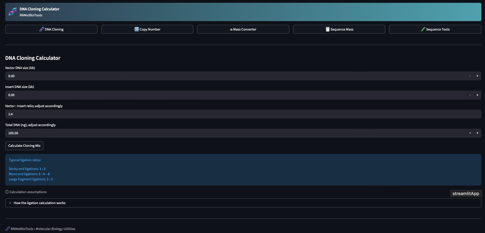

# 🧬 DNA Cloning Calculator

# RNMolBioTools

RNMolBioTools is a web-based molecular biology toolkit built using Streamlit. It provides a set of interactive tools for DNA cloning, sequence analysis, primer design, and related molecular biology computations. This toolkit is designed for researchers, students, and bioinformatics enthusiasts to quickly perform calculations, visualize DNA features, and analyze sequences in an easy-to-use web interface.
---
## 🔗 Live Application
Click the badge below to run the calculator live in your browser:

[](https://dna-cloning-calculator-npbb5qqzmfe4nfqvuw5fdj.streamlit.app/)

👉 [Launch DNA Cloning Calculator](https://dna-cloning-calculator-npbb5qqzmfe4nfqvuw5fdj.streamlit.app/)



---

## Table of Contents

1. Project Overview
2. Features
3. Folder Structure
4. Installation
5. Usage
6. Deployment
7. Dependencies
8. Testing
9. License

---

## 1. Project Overview

RNMolBioTools integrates several molecular biology utilities, including:

* DNA cloning calculators
* Copy number and mass calculations
* Sequence mass and validation
* Primer design and analysis
* Restriction enzyme analysis
* Sequence alignment and visualization

The project is designed as a single-page application with a sidebar navigation system, powered by Streamlit's wide layout configuration to make full use of the screen for a web-like experience.

---

## 2. Features

### Core Tools

* **DNA Cloning Calculator**: Compute pmol and copy number based on DNA length and mass.
* **Copy Number Calculator**: Quickly determine DNA molecule copy numbers.
* **Mass Converter**: Convert DNA mass from nanograms to picomoles.
* **Sequence Mass Calculator**: Compute sequence length and validate sequences.
* **Sequence Tools**: Complement, reverse complement, GC content calculation, restriction site detection, and pairwise alignment.
* **Primer Designer**: Analyze primers for GC content, melting temperature, GC clamp, hairpin risk, and dimer formation.

### Visualization Tools

* Sliding window GC content plots
* Gel electrophoresis simulation
* Circular plasmid map generation
* Pairwise sequence alignment visualization

---

## 3. Folder Structure

```
RNMolBioTools/
│
├── app.py
├── requirements.txt
├── README.md
│
├── pages/
│   ├── cloning_page.py
│   ├── copy_number_page.py
│   ├── mass_converter_page.py
│   ├── sequence_mass_page.py
│   ├── sequence_tools_page.py
│   └── primer_design_page.py
│
├── core/
│   ├── dna_math.py
│   ├── sequence_utils.py
│   ├── alignment_algorithms.py
│   ├── primer_design.py
│   ├── restriction_analysis.py
│   ├── translation.py
│   └── orf_finder.py
│
├── visualization/
│   ├── gc_content_plot.py
│   ├── gel_simulator.py
│   ├── plasmid_map.py
│   └── alignment_visualizer.py
│
├── utils/
│   ├── validators.py
│   ├── fasta_parser.py
│   ├── file_export.py
│   └── constants.py
│
├── components/
│   ├── header.py
│   ├── navbar.py
│   ├── footer.py
│   └── ui_helpers.py
│
├── data/
│   ├── restriction_enzymes.json
│   └── codon_table.json
│
└── tests/
    ├── test_dna_math.py
    ├── test_sequence_utils.py
    └── test_alignment.py
```

---

## 4. Installation

1. Clone the repository:

```bash
git clone https://github.com/Eric428-a/RNMolBioTools.git
cd RNMolBioTools
```

2. Create a virtual environment (optional but recommended):

```bash
python -m venv venv
source venv/bin/activate  # On Windows: venv\Scripts\activate
```

3. Install dependencies:

```bash
pip install -r requirements.txt
```

---

## 5. Usage

Run the Streamlit application:

```bash
streamlit run app.py
```

The application opens in your default web browser. Use the sidebar navigation to select tools and input DNA sequences, primers, or other parameters as required.

### UI Notes

* Only the main app sidebar item is active; all pages are loaded dynamically within the main window.
* The layout is set to `wide` for a full-screen web experience.
* Footer and header are professional and fixed styling for all pages.

---

## 6. Deployment

You can deploy RNMolBioTools on Streamlit Cloud or other platforms like Render. Steps for Render deployment:

1. Create a new Web Service using Render dashboard.
2. Connect your GitHub repository.
3. Select Python environment and set the build command:

```bash
pip install -r requirements.txt
```

4. Set the start command:

```bash
streamlit run app.py
```

5. Deploy and access your app using the Render-provided URL.

---

## 7. Dependencies

Key Python packages include:

* streamlit
* pandas
* matplotlib

Other dependencies are listed in `requirements.txt`.

---

## 8. Testing

Unit tests are provided in the `tests` folder. Run tests with:

```bash
pytest tests/
```

This ensures core calculations and sequence analysis modules work correctly.

---

## 9. License

This project is open source. You can modify and redistribute under the terms of the MIT License.

---

## 10. Contact

For issues or contributions, please open a GitHub issue or pull request in the repository.


